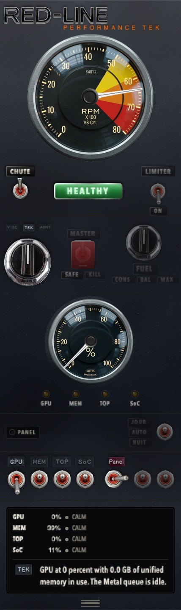

# Magnet Napkin

**A napkin for your assets.** Drop a folder of images onto a canvas of a known size, move them around like magnets, and export the layout.

> **Status:** pre-build. The build brief, scope and technical decisions are in [`01-MAGNET-NAPKIN-HANDOVER.md`](01-MAGNET-NAPKIN-HANDOVER.md). The working rules and harness setup are in [`AGENTS.md`](AGENTS.md).

## The idea

Every layout starts as a pile of assets and a rough arrangement. Magnet Napkin is the smallest tool for that moment:

- drop a folder of images in;
- set the canvas to the real size in px, pt, mm or inches;
- drag, resize (aspect locked) and rotate the images;
- add basic text that belongs to the design;
- add notes that explicitly do **not** belong to the design;
- read exact positions and sizes;
- export a clean PNG, an annotated PNG, a JSON layout and a notes brief for a vision agent.

No accounts. No cloud. No install. No build step.

## The first board

The first project is the **RED-LINE GT40 cockpit** at 214 × 719 pt — a real panel with real dial, toggle and label assets.

*The first board: the RED-LINE GT40 cockpit at 214 × 719 pt. RED-LINE is a separate private project; this is a promotional capture, used with permission. The layout board and its notes will follow once the first build is in.*

## Planned shape

A single static page — HTML, CSS and vanilla JavaScript — that runs from disk or GitHub Pages. Assets stay local. The current project and its images are cached in the browser so reopening the page restores the board.

## Build

The MVP scope, data model, file format, UX shape, acceptance criteria and first-session prompt are all in [`01-MAGNET-NAPKIN-HANDOVER.md`](01-MAGNET-NAPKIN-HANDOVER.md).

Working rules, MCP/skill choices and the gate live in [`AGENTS.md`](AGENTS.md). If you are building on DeepSeek Harness, read [`docs/AGENTS-DSH.md`](docs/AGENTS-DSH.md). For another project, copy [`docs/AGENTS-TEMPLATE.md`](docs/AGENTS-TEMPLATE.md) and fill the placeholders.

## License

MIT. See [`LICENSE`](LICENSE).
