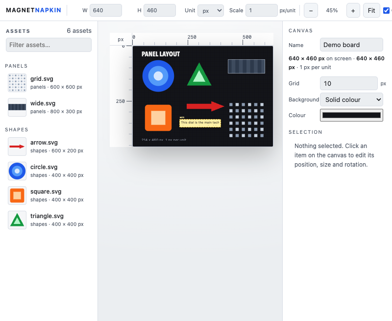

# Magnet Napkin

**A napkin for your assets.** Drop a folder of images onto a canvas of a known size, move them around like magnets, leave notes that are clearly *not* part of the design, and export the layout plus a brief for a vision agent.

No accounts. No cloud. No install. No build step. No network calls after the page loads.



## The idea

Every layout starts as a pile of assets and a rough arrangement. Magnet Napkin is the smallest tool for that moment:

- **drop a folder of images in** — drag it onto the page, or use the button;
- **set the canvas to the real size** — 214 × 719 pt, or millimetres, or inches;
- **move, resize and rotate** — the aspect ratio stays locked until you say otherwise;
- **read exact numbers** — X, Y, W and H in the canvas unit *and* in board pixels, live in the inspector;
- **add text** that belongs to the design;
- **add notes** that explicitly do not;
- **export four files**: the clean PNG, the annotated PNG, the exact geometry as JSON, and a written brief.

The board is the point. The layout is a by-product: it is what you hand to a developer, or to an agent with eyes.

The chrome is dark, quiet and glassy — translucent panels over a soft wallpaper, with the board as the only opaque thing on screen. Nothing in the interface competes with your artwork.

## Quick start

**The plain way.** Download or clone the repo and open `index.html` in a browser. That is the whole installation.

**The way that remembers.** Chrome does not allow IndexedDB on `file://` pages, so autosave needs a real origin:

```sh
./serve.sh            # → http://localhost:8123/
```

**Try it without your own assets.** The `samples/` folder holds a few original placeholder images. Drop `samples/` onto the page and drag something onto the canvas.

## Using it

1. **Import** a folder of images. They land in the tray on the left, grouped by folder, searchable.
2. **Set the canvas**: width, height, unit and scale, top left. The scale is how many pixels one unit is worth — a 214 pt panel at 2× is a 428 px grid.
3. **Place** an asset by dragging it from the tray onto the canvas, or by clicking it to drop it in the middle. It arrives at its own size — set **Asset ratio** to `2` if your files are `@2x` artwork.
4. **Arrange**: drag to move, corner handle to resize, the circle above the item to rotate (hold <kbd>Shift</kbd> for 15° steps). The inspector shows the value in canvas units *and* in board pixels, the way the Redline board always did.
5. **Type** the exact numbers into the inspector when the pixels are not enough.
6. **Set the background** if the board is not a light grey: a solid colour, a checker, or one of your own images. A faint **underlay** of any image from the tray can sit under the artwork as a tracing aid — like the grid, it never reaches the exported PNG.
7. **Add notes** where a decision needs explaining.
8. **Hand it over**: the Handoff button gives you the four files.

Shortcuts are in [docs/SHORTCUTS.md](docs/SHORTCUTS.md). The file format is in [docs/FORMAT.md](docs/FORMAT.md).

## The handoff

The **Handoff** button produces four files, one click each — browsers block multiple automatic downloads, so nothing is fired behind your back:

| File | What it is |
|---|---|
| `layout.png` | the clean design. No notes, no grid, no selection. |
| `layout-annotated.png` | the same board with the notes visible, badge and all. |
| `layout.json` | the machine contract: canvas, assets, items, notes, order and geometry. |
| `notes.md` | the brief. For a human or for a model. |

**Copy handoff** puts a compact version of the brief on the clipboard.

The point of the two PNGs: a note is commentary, and commentary must never be mistaken for artwork. The clean PNG is the design. The annotated PNG shows where the reasoning is. A note is sticky yellow with a dashed border and a `NOTE` badge, so it cannot be mistaken for the design even by someone who cannot see the colour.

[docs/AGENT_HANDOFF.md](docs/AGENT_HANDOFF.md) has the details of how to give this to an agent.

## Notes and text are different things

This is the one rule the whole tool is built around:

- **Text** is design content. It sits in the `items` array, it has a z-order, it locks and fades like anything else, and it is in the clean PNG.
- **A note** is commentary. It lives in its own `notes` array, it draws on top of the artwork, it has its own font and paper colour, and it is **never** in the clean PNG.

They are never merged. The JSON keeps them apart, and so does the export.

## Your board is safe

The board is the work, so losing it is not an option. Magnet Napkin keeps it
in the browser's own storage and is careful about it:

- **Every change is snapshotted.** The **History** button lists the versions
  with their times and item counts, and any of them can be restored.
  Restoring keeps the board you have now in the history too.
- **A second tab cannot overwrite you.** If another tab saves a newer board,
  this tab stops and says so, and offers to reload or to keep writing. It
  never wins by being last.
- **An empty board never replaces a full one.** If this tab has nothing in it
  and the stored board has something, the save is refused and the status line
  says why.
- **A view change is not a layout change.** Moving the zoom or toggling the
  grid is saved on its own and never rewrites the board.

The rules and the reasoning are in
[docs/AUTOSAVE_AND_RECOVERY.md](docs/AUTOSAVE_AND_RECOVERY.md), which exists
because a real 34-magnet Redline layout was lost to exactly this failure.

## Privacy

Everything stays on your machine. The page loads nothing from the network, sends nothing anywhere, and keeps no analytics. The board and its images live in your browser's own storage (IndexedDB) so that reopening the page restores it. You can wipe that with **New** or by clearing site data.

SVG files are loaded through ``, so they cannot run scripts. Text from files and from your notes is inserted as text, never as markup.

## The browser

Current Chrome, Safari and Firefox. Firefox has no `webkitGetAsEntry`, so folder drops there use the File System Access API instead; the **Import folder…** button works everywhere.

## Licence

MIT. See [LICENSE](LICENSE).

The first board this tool was built for was the RED-LINE GT40 cockpit at 214 × 719 pt — a private project, unrelated to this repository. The capture in the README is a promotional still, used with permission; no Redline source asset, font or brand file is in this repository.

A [clip of the prototype this replaced](docs/demo/redline-prototype-demo.mp4)
is in `docs/demo/` — the old Redline PanelBoard, doing the same job with
hardcoded artwork. It is a record of where this came from, not a demo of this
app.
